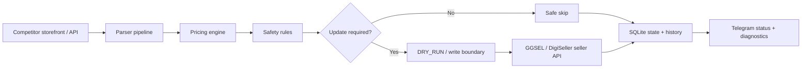

# Auto-Pricing Bot for GGSEL + DigiSeller

Production automation service for **competitor monitoring, seller-side repricing and order-chat operations** on GGSEL and DigiSeller.

The project is used as a real marketplace automation runtime: it monitors competitor offers, calculates target prices under configurable limits, updates seller prices through marketplace APIs, persists state/history, and exposes operational control through Telegram.

<div align="center">

[](https://www.python.org/)
[](https://core.telegram.org/bots)
[](https://sqlite.org/)
[](https://www.docker.com/)
[](https://pytest.org/)
[](https://github.com/Urushihara24/monitoring-bot/actions/workflows/ci.yml)
[](https://github.com/Urushihara24/monitoring-bot/actions/workflows/security.yml)
[](https://github.com/Urushihara24/monitoring-bot/releases/latest)
[](LICENSE)

**GGSEL · DigiSeller · Telegram Bot API · REST APIs · Python · SQLite · Docker · GitHub Actions · pytest**

</div>

> 👋 **Contributions are welcome.** Check open issues and assignees before starting so work is not duplicated. [#42 — sanitized storefront parser regression fixtures](https://github.com/Urushihara24/monitoring-bot/issues/42) is currently claimed by an external contributor and serves as an example of a focused, credential-free contribution.

---

## Product snapshot

| Area | Production capability |
|---|---|
| **Marketplaces** | Independent GGSEL and DigiSeller profiles |
| **Monitoring** | Multiple product↔competitor mappings with parser fallbacks |
| **Pricing** | Follow, undercut, raise and showcase-cycle strategies |
| **Seller API** | Idempotent price updates, read verification and no-op protection |
| **Safety** | `DRY_RUN`, min/max boundaries, max downward step, cooldowns, weak-signal filtering |
| **Order chat** | Optional rules-based auto-replies with allow-lists and deduplication |
| **State** | SQLite runtime settings, price history, alerts and per-product state |
| **Operations** | Telegram status, diagnostics and smoke controls |
| **Deployment** | Docker Compose, health checks, graceful stop contract and non-root runtime path |
| **Quality** | Python 3.11/3.12 CI, pytest, Ruff, compile checks, dependency audit and secret scan |

---

## Try it safely — no seller credentials

You can evaluate the pricing engine and runtime contract without Telegram, marketplace credentials or any real seller writes.

```bash
python3 -m venv .venv
source .venv/bin/activate
pip install -r requirements.txt

python3 scripts/demo_pricing.py \
  --mode DUMPING \
  --competitor 0.35 0.37 \
  --current 0.36

python3 scripts/demo_runtime.py
```

Both demo paths are offline: **zero marketplace API writes and zero seller credentials required**. The full runtime starts in `DRY_RUN=true` as an additional write-safety boundary.

---

## Tech stack

### Runtime

- **Python 3.11 / 3.12**
- **python-telegram-bot 22.x** — operator UI and Telegram control plane
- **requests** — marketplace/API integration
- **BeautifulSoup4** — competitor storefront parsing
- **stealth-requests** — resilient storefront requests
- **python-dotenv** — runtime environment loading
- **SQLite** — persisted pricing state, runtime settings, history and alert metadata
- **asyncio** — scheduler/orchestration

### Integration surface

- **GGSEL Seller API**
- **DigiSeller API**
- **GGSEL / DigiSeller storefront parsing**
- **Telegram Bot API**

### Delivery & quality

- **Docker / Docker Compose**
- **GitHub Actions**
- **pytest / pytest-asyncio**
- **Ruff**
- **pip-audit**
- custom tracked-secret scanning
- image and runtime health checks

---

## Architecture



Profiles are isolated: credentials, products, competitor URLs, settings, state, history and alerts are stored independently. Product-scoped schedulers keep runtime configuration separated for each active pair.

---

## Pricing and safety

The service supports several pricing modes while enforcing operational constraints before every marketplace write.

**Follow** — match the competitor price.

**Undercut** — move below the selected competitor under configured limits.

**Raise** — move above the selected competitor when the active strategy requires it.

**Showcase cycle** — GGSEL-specific cycle that can restore the configured desired price after the competitive action is complete.

Safety controls include:

- write-safe onboarding with `DRY_RUN=true`;
- minimum and maximum price boundaries;
- maximum downward movement per update;
- cooldown and fast-rebound handling;
- weak/unknown-rank competitor filtering;
- idempotent seller updates;
- post-update price verification;
- safe skip on missing or incomplete competitor data;
- per-product enable/disable state;
- chat auto-reply suppression in dry-run mode.

---

## Competitor parsing

The runtime does not depend on one fragile selector. GGSEL parsing uses a fallback chain:

1. storefront HTML request;
2. unit-price extraction where available;
3. CSS price selectors;
4. public product endpoint fallback for supported GGSEL domains.

For every cycle the service persists the selected competitor URL, price, rank when available, parsing method, timestamp and error/blocking state for diagnostics.

---

## Order-chat automation

GGSEL and DigiSeller integrations can optionally send product instructions to buyer chats.

The implementation includes:

- per-profile enable/disable;
- product allow-lists;
- order/first-message/code-only policies;
- rules bound to selected product options;
- locale-aware instruction lookup;
- message-history deduplication;
- empty-chat and smart non-empty-chat policies;
- sent-state retention and cleanup;
- permission checks and rate-limit throttling;
- service-message deny guards.

Marketplace chat writes are blocked by `DRY_RUN=true`.

---

## Safe verification without seller credentials

The repository includes two offline verification paths for maintainers and CI.

Single pricing decision:

```bash
python3 scripts/demo_pricing.py \
  --mode DUMPING \
  --competitor 0.35 0.37 \
  --current 0.36
```

Multi-cycle fake marketplace runtime:

```bash
python3 scripts/demo_runtime.py
```

The fake runtime uses the same marketplace contract but performs **zero network calls and zero real marketplace writes**.

---

## Local run

```bash
python3 -m venv .venv
source .venv/bin/activate
pip install -r requirements.txt
pip install -r requirements-dev.txt
cp .env.example .env
```

New configurations start with:

```dotenv
DRY_RUN=true
```

Run:

```bash
python3 -m src
```

Before switching to `DRY_RUN=false`, verify seller/profile IDs, competitor mappings, price boundaries and active products.

---

## Docker

Backward-compatible runtime:

```bash
docker compose up -d --build
docker compose logs -f
```

A separate non-root image/Compose path is available for hardened deployments using named volumes. See [`DEPLOY.md`](DEPLOY.md).

---

## Verification

```bash
pytest -q
ruff check src tests scripts --select F,E9
python3 -m compileall -q src scripts healthcheck.py
python3 scripts/check_secrets.py
```

Read-only seller API smoke:

```bash
python3 scripts/smoke_profiles_api.py --profile all --verify-read
```

Write-capable smoke probes are deliberately blocked while `DRY_RUN=true`.

---

## Repository map

```text
src/main.py                         startup, lifecycle and profile wiring
src/scheduler_factory.py            DRY_RUN scheduler selection and write boundary
src/modular_scheduler.py            active scheduler facade
src/scheduler_runtime_host.py       low-level compatibility host with fail-closed extracted methods
src/parser_coordinator.py           competitor parser coordination
src/pricing_cycle_coordinator.py    pricing-cycle orchestration and write-result handling
src/notification_policy.py          notification/throttling policy
src/chat_autoreply_coordinator.py   marketplace chat auto-reply orchestration
src/logic.py                        pricing rules
src/marketplace.py                  marketplace protocol + in-memory fake client
src/rsc_parser.py                   competitor parser
src/api_client.py                   GGSEL seller API
src/digiseller_client.py            DigiSeller API
src/modular_telegram_routed_bot.py  active Telegram runtime facade
src/telegram_router.py              command/message/callback/error routing
src/telegram_settings_flow.py       Telegram settings mutations and validation
src/telegram_views.py               keyboard/inline markup builders
src/telegram_rendering.py           status/diagnostics rendering
src/storage_repositories.py         focused active persistence boundaries
src/storage.py                      SQLite bootstrap/migrations compatibility facade
src/scheduler.py                    frozen legacy scheduler compatibility/reference surface
src/telegram_bot.py                 legacy Telegram compatibility surface
scripts/                            smoke, demo and operational tooling
docs/                               architecture, dry-run and release documentation
```

---

## Documentation

- **[Customer guide](INSTRUCTION_CUSTOMER.md)** — operational setup and usage
- **[Operations reference](OPERATIONS.md)** — pricing/runtime/smoke details
- **[Architecture](docs/ARCHITECTURE.md)** — runtime boundaries and state model
- **[Dry-run safety](docs/DRY_RUN.md)** — marketplace write-safety contract
- **[Deployment](DEPLOY.md)** — Docker and deployment paths
- **[Security](SECURITY.md)** — vulnerability reporting and secret handling
- **[Contributing](CONTRIBUTING.md)** — engineering workflow and verification
- **[Changelog](CHANGELOG.md)** — notable runtime and operational changes

---

## Project status

This is a working marketplace automation project, not a tutorial repository. The public codebase is structured so production-sensitive credentials and account data stay outside Git while the runtime, safety mechanisms, tests and operational tooling remain reviewable.

The post-v1 modularization tracked in #24 is complete. The active runtime uses explicit scheduler, Telegram and persistence boundaries; the historical monolithic modules remain only where compatibility and regression coverage still require them. Further feature work should target the modular runtime surfaces rather than extend the legacy orchestration classes.

---

## Feedback & contributions

If you work with GGSEL, DigiSeller or marketplace automation, real-world edge cases are useful: bug reports, parser failures, API behavior differences and focused pull requests are welcome.

[#42 — sanitized storefront parser regression fixtures](https://github.com/Urushihara24/monitoring-bot/issues/42) is currently in progress by an external contributor, so please do not duplicate that work. Check current open issues first; if none fits, open a focused proposal before starting. See [CONTRIBUTING.md](CONTRIBUTING.md) for setup and verification.

If this project is useful to you, starring the repository helps other marketplace-automation developers discover it.
