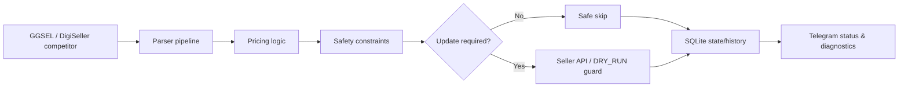

# Auto-Pricing Bot for GGSEL + DigiSeller

Telegram-controlled **competitor-price monitoring and automatic repricing** for digital-goods sellers.

The bot watches configured competitor products, calculates a target price under safety rules, updates seller prices through marketplace APIs, and keeps runtime state/history for diagnostics.

<div align="center">

[](https://www.python.org/)
[](https://core.telegram.org/bots)
[](https://www.docker.com/)
[](https://pytest.org/)
[](https://github.com/Urushihara24/monitoring-bot/actions/workflows/ci.yml)
[](LICENSE)

**GGSEL · DigiSeller · Telegram · Python · Docker · pytest**

</div>

---

## Why this exists

Manual competitor-price checking is slow and inconsistent. Generic webpage monitors can tell you that a number changed, but they do not manage seller-side repricing state, marketplace API writes, product-specific limits or safe update behavior.

This project combines the full loop:

```text
competitor page/API
        ↓
price parsing + fallbacks
        ↓
pricing strategy
        ↓
safety constraints
        ↓
seller API update / safe skip
        ↓
state + history + Telegram diagnostics
```

If this is useful for your marketplace workflow, **a ⭐ helps other sellers and Python developers find the project.**

---

## Highlights

| Area | What is implemented |
|---|---|
| **Marketplaces** | Independent GGSEL and DigiSeller profiles |
| **Monitoring** | Multiple products, product↔competitor mappings, parser fallbacks |
| **Pricing** | Follow, undercut and raise strategies |
| **Safety** | Write-safe `DRY_RUN`, min/max price, max downward step, cooldowns, weak-signal filtering |
| **Reliability** | Idempotent writes, no-op skips, persisted runtime state/history |
| **Operations** | Telegram status/diagnostics/smoke controls |
| **Deployment** | Docker Compose and health checks |
| **Verification** | pytest suite, smoke scripts and GitHub Actions |

---

## Architecture



The profiles are isolated: credentials, products, competitors, settings, state and alerts are stored independently per marketplace/profile.

---

## Pricing strategies

**Follow** — match the competitor price.

**Undercut** — price slightly below the competitor under configured limits.

**Raise** — price slightly above the competitor when that strategy is desired.

Every product can keep its own pricing mode and limits.

Safety behavior includes:

- write-safe onboarding with `DRY_RUN=true`;
- minimum and maximum price boundaries;
- protection against large sudden downward moves;
- cooldown handling and fast upward rebound;
- idempotent seller API updates;
- safe skip when the desired price is already applied;
- safe skip when competitor data is unavailable or incomplete.

---

## Try the pricing engine without credentials

You can run the real pricing decision logic locally without Telegram, marketplace accounts or seller API writes:

```bash
python3 scripts/demo_pricing.py
```

Example with explicit values:

```bash
python3 scripts/demo_pricing.py \
  --mode DUMPING \
  --competitor 0.35 0.37 \
  --current 0.36
```

Machine-readable output is available for experiments and tests:

```bash
python3 scripts/demo_pricing.py --mode FOLLOW --competitor 0.35 --format json
```

The simulator never calls marketplace write endpoints; it only executes the local pricing engine and prints the resulting decision.

---

## Competitor parsing

For GGSEL, the parser uses a fallback chain rather than relying on one fragile selector:

1. HTML request;
2. unit-price extraction when available;
3. CSS price selectors;
4. GGSEL public product endpoint fallback for supported domains.

The bot stores the last successful price, URL, parsing method, timestamp and parser error state for diagnostics.

---

## Quick start

```bash
python3 -m venv .venv
source .venv/bin/activate
pip install -r requirements.txt
pip install -r requirements-dev.txt
cp .env.example .env
```

The example configuration starts in **write-safe mode**:

```dotenv
DRY_RUN=true
```

In this mode the normal parser and pricing decision path runs, but seller price writes and marketplace chat auto-replies are blocked. Configure Telegram, seller credentials, product IDs and limits, run the bot, inspect logs/decisions, and only then explicitly arm marketplace writes:

```dotenv
DRY_RUN=false
```

Invalid explicit values such as `DRY_RUN=treu` fail startup instead of silently enabling writes.

Run locally:

```bash
python3 -m src
```

Or with Docker:

```bash
docker compose up -d --build
docker compose logs -f
```

Existing installations that do not define `DRY_RUN` keep the historical write-enabled behavior for backward compatibility. New installations created from `.env.example` are safe by default.

The Telegram UI is currently Russian.

---

## Useful commands

```text
/start
/status
/status <profile>
/diag
/diag <profile>
/smoke
/smoke <profile>
```

Profiles accept aliases such as `gg`, `ggsel`, `digi`, `dg`, `digiseller` and `plati`.

---

## Verification

Run the test suite:

```bash
pytest -q
```

Compile-check the runtime and utility scripts:

```bash
python3 -m compileall src scripts healthcheck.py
```

Read-only seller API smoke:

```bash
python3 scripts/smoke_profiles_api.py --profile all --verify-read
```

The repository also includes profile-specific smoke checks, chat-permission checks and optional mutation/rollback verification.

---

## Documentation

- **[Customer guide](INSTRUCTION_CUSTOMER.md)** — non-technical setup and usage.
- **[Operations reference](OPERATIONS.md)** — detailed runtime, pricing and smoke-check notes.
- **[Deployment](DEPLOY.md)** — deployment instructions.
- **[Tests](tests/)** — automated verification.
- **[Source](src/)** — application code.

---

## Main code areas

```text
src/main.py               startup / orchestration
src/scheduler.py          parse → calculate → update/skip cycle
src/scheduler_factory.py  runtime write-safety / DRY_RUN boundary
src/logic.py              pricing rules
src/rsc_parser.py         competitor parser
src/api_client.py         GGSEL seller API
src/digiseller_client.py  DigiSeller API
src/telegram_bot.py       Telegram UI and handlers
src/storage.py            SQLite state/history/alerts
```

---

## Scope

This project is designed for sellers automating **their own marketplace accounts and product pricing**. Marketplace/API rules can change, so seller API behavior and credentials should be verified in `DRY_RUN` before enabling automatic writes.

---

### Found it useful?

Give the repository a **⭐** — it is the simplest way to help this project reach other developers working on marketplace automation and repricing.
